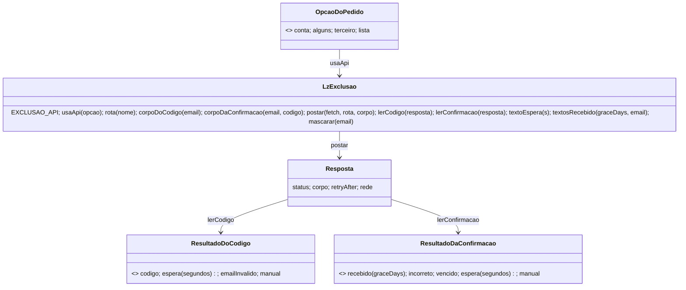

# A página /excluir-conta chama a API de exclusão (STORY-001-001)

> Requisito: `requirements/[User-story-01]excluir-conta-pela-api.md` · Análise: `spdd/analysis/GGQPA-XXX-202610261513-[Analysis]-excluir-conta-pela-api.md` · API: REQ-056 (`../app-backend/docs/contrato-integracao.md` §EXC, backend `c17aed4`) · Protótipo: `components/conta/excluir-conta.tsx` (`EXC3`, `EXC4`).
> **Status:** APROVADO — por delegação: Natanael, 2026-10-26, segue a cadeia. Literal: "Gere todas as cadeias de sementes SPDD para implementarmos essa feature de exclusão de conta app + api + banco de dados. Siga boas práticas de recomendações. Evite realizar testes desnecessários por conta do longo tempo de espera. Faça apenas testes enxutos e essenciais." e "opção 1 pois o site é um repositorio que eu preciso dar manutenção e o spdd é essencial."

## Requirements

"Excluir minha conta" na página pública pede o código e confirma pelas rotas públicas do REQ-056, com resposta neutra, prazo de `graceDays`, reenvio, espera de `429` e o pedido por e-mail como rede de segurança. Recorte: só `kind: "ACCOUNT"`; as outras 3 opções seguem por e-mail. Fora: backend e CORS (pendência de infra), link dos documentos (DP-5612), textos de política.

## Entities

Conservador: `TIPOS`, `PRAZOS` e os passos (`email`, `codigo`, `recebido`, `email-manual`) da página ficam. Os resultados são objetos simples `{ tipo, … }`.

## Approach

- Lógica pura em `lp/excluir-conta.js` (UMD: `window.LzExclusao` no navegador, `module.exports` no Node), sem DOM e sem `console`. A página carrega o arquivo antes do script inline e só liga eventos e textos.
- `EXCLUSAO_API` vive **só** nesse arquivo: a base do app (`ambiente_api.dart`, Lambda dev). Vazio continua significando "sempre e-mail".
- Decididas (recomendação, aprovação da semente): D1 base do app num ponto só · D2 tela do código igual para todo `2xx` · D3 sem link dos documentos, `hasCompany` não muda texto · D4 `403`/`5xx`/`422 DELETION_KIND_NOT_SUPPORTED`/rede/CORS/timeout → e-mail · D5 backend intocado.
- Reaproveita: `mascarar`, `erro()`, `mostrar()`, o fallback `email-manual` e o mailto por opção.

## Structure

| Arquivo | Muda | Operation |
|---|---|---|
| `lp/excluir-conta.js` | nasce | OP-1 |
| `lp/excluir-conta.html` | script inline, passo do código, recebido, e-mail manual, comentário de cabeçalho | OP-2 |
| `testes/excluir-conta.test.mjs` | nasce | OP-3 |
| `package.json` | `scripts.test` = `node --test testes/` | OP-3 |
| `requirements/INDEX.md`, `spdd/INDEX.md` | linha da cadeia | OP-4 |

Sem mudança em `lp/vercel.json`, `.vercelignore` e `build-lp.mjs`.

## Operations

### OP-1 Lógica da exclusão (STORY-001-001)

- **Arquivo:** `lp/excluir-conta.js`.
- `EXCLUSAO_API`: `https://cu2viedkfvwuiuauvvi4guzdnm0ktprm.lambda-url.sa-east-1.on.aws/api/v1/`.
- `usaApi(opcao)`: verdadeiro só para `conta` e com base não vazia.
- `rota(nome)`: base com barra final + `account-deletion/code` (`codigo`) ou `account-deletion` (`confirmar`).
- `corpoDoCodigo(email)` → `{ email, kind: 'ACCOUNT' }`; `corpoDaConfirmacao(email, codigo)` → `{ email, code, kind: 'ACCOUNT' }`. E-mail com `trim`. Nenhum outro campo.
- `postar(fetch, url, corpo, ms=15000)`: `POST` JSON só com `Content-Type`, `AbortController` no tempo; resolve sempre `{ status, corpo, retryAfter }` ou `{ rede: true }` (rejeição, CORS, timeout). Corpo ilegível vira `{}`.
- `segundosDeEspera(retryAfter)`: inteiro ≥ 1 em segundos, ou data HTTP no futuro; ausente/ilegível → 60.
- `lerCodigo(r)`: `2xx` → `codigo`; `429` → `espera`; `400` → `emailInvalido`; resto/rede → `manual`.
- `lerConfirmacao(r)`: `200` → `recebido` com `graceDays` (inteiro > 0; senão `PRAZO_PADRAO_DIAS` 30); `422 VERIFICATION_CODE_INVALID` e `400` → `incorreto`; `422 VERIFICATION_CODE_EXPIRED` → `vencido`; `429` → `espera`; resto/rede → `manual`.
- `textoEspera(s)` e `textosRecebido(graceDays, email)`: os textos do Safeguard.
- **Verifica:** OP-3.

### OP-2 A página liga a lógica (STORY-001-001)

- **Arquivo:** `lp/excluir-conta.html`.
- `` antes do script inline; o inline lê `LzExclusao` e apaga o `EXCLUSAO_API` e o contrato antigo do comentário.
- Passo `email`: se `!usaApi(opcao)` → `email-manual` com o motivo "outra opção"; senão `postar(codigo)` com o botão desabilitado enquanto espera; `codigo` → passo do código, máscara, contagem de 60 s; `espera` → erro no e-mail com `textoEspera`; `emailInvalido` → "Confira o e-mail."; `manual` → `email-manual` com o motivo "falha".
- Passo `codigo`: "Excluir minha conta" (habilitado com 6 dígitos) → `postar(confirmar)`; `recebido` → passo recebido com `textosRecebido`; `incorreto`/`vencido`/`espera` → erro no código, botão volta; `manual` → `email-manual` (falha).
- Reenvio: linha "Não chegou? Confira o spam ou peça um novo em {s}s." e, a 0 s, o botão "Reenviar código" → `postar(codigo)` com o mesmo corpo; `codigo` reinicia a contagem; `espera` → erro com `textoEspera`; `manual` → `email-manual`.
- "Usar outro e-mail" para a contagem.
- E-mail manual: `
` com o texto do motivo, escondido quando não há.
- Recebido: textos de `textosRecebido`; o "desfazer" só em `conta` (como hoje).
- Comentário do cabeçalho: cita este canvas e a pendência do CORS, sem texto sensível (vai ao ar).
- **Verifica:** OP-3 (o script inline parseia) e build.

### OP-3 Testes (STORY-001-001)

- **Arquivo:** `testes/excluir-conta.test.mjs` (`node:test`, `fetch` falso, sem rede, sem navegador). `package.json` `test`.
- Casos: corpos só com `email`/`code`/`kind: 'ACCOUNT'`; `usaApi` só `conta`; rotas; `lerCodigo` (202, 429 com 120, 400, 422 kind, 500, rede); `lerConfirmacao` (200 com 45, INVALID, EXPIRED, 429, 403, rede); `postar` com `fetch` que rejeita → `{rede:true}`; `segundosDeEspera`; textos de espera e recebido; o `<script>` inline da página parseia (`vm.Script`) e não tem `console.`.
- **Verifica:** `npm test` verde; `cd lp && node build-lp.mjs` sem erro.

### OP-4 Registro

- Linha em `spdd/INDEX.md` (canvas ↔ análise) e confirmação em `requirements/INDEX.md`; `## Sync` neste canvas se o código divergir sem mudar comportamento.

## Norms

- `CLAUDE.md` §Regras (consentimento/GTM intocados, sem PII em URL/console, protótipo como fonte, comentário vai ao ar).
- `.claude/spdd-perfil.md` §Generate (testes Node, sem Playwright, sem API real).
- JS no estilo da página: ES5 (`var`, `function`), `'use strict'`, IIFE, sem dependência.

## Safeguards

- **S1 neutro:** a tela do código é a mesma para todo `2xx`; nenhum texto depende de a conta existir. Texto mantido: "Se houver um cadastro com {máscara}, mandamos para ele um código de 6 dígitos, que vale por 10 minutos."
- **S2 só ACCOUNT:** nenhuma chamada à API para `alguns`, `terceiro`, `lista`; corpo só `email`, `code`, `kind`.
- **S3 sem PII exposta:** e-mail e código só no corpo do `POST`; nada em URL, query, `console` ou `dataLayer`.
- **S4 fallback:** toda falha não prevista cai em "Mande seu pedido por e-mail".
- **S5 textos exatos:**
  - recebido: "Sua conta foi desativada agora. A exclusão termina em {N} dias." · "Enviamos a confirmação para {máscara}." · "Mudou de ideia? Entre de novo no app com seu e-mail e senha em até {N} dias e tudo volta como estava." ({N} = `graceDays`);
  - código: "Código incorreto." · "Este código venceu. Peça um novo." · "Não chegou? Confira o spam ou peça um novo em {s}s." · "Reenviar código";
  - espera: "Muitas tentativas. Tente de novo em {s} segundos." (até 119 s) · "Muitas tentativas. Tente de novo em {m} minutos." (arredondado para cima);
  - e-mail manual, outra opção: "Por enquanto, este pedido é feito por e-mail." · falha: "Não conseguimos enviar o código agora.";
  - nunca "com o link dos seus documentos" (DP-5612).
- **S6 deploy:** `vercel.json`, `.vercelignore` e `build-lp.mjs` intocados.

## Matriz de rastreabilidade

| AC | Operation | Verificação |
|---|---|---|
| AC1 | OP-1 `corpoDoCodigo`, `lerCodigo`; OP-2 | teste corpo e 202 |
| AC2 | OP-1 `lerConfirmacao`, `textosRecebido`; OP-2 | teste 200 com 45 |
| AC3 | OP-1 `lerConfirmacao`; OP-2 | teste INVALID/EXPIRED |
| AC4 | OP-1 `segundosDeEspera`, `textoEspera` | teste 429 com 120 → "2 minutos" |
| AC5 | OP-2 reenvio | leitura do código (sem E2E) |
| AC6 | OP-1 `usaApi`; OP-2 motivo | teste `usaApi` |
| AC7 | OP-1 `postar`, `lerCodigo`; OP-2 | teste rede/500/422 kind; inline sem `console.` |

## Decisões pendentes

- **Infra (bloqueante para o AC1–AC5 no ar):** acrescentar `https://www.legalizai.com.br` (e `https://legalizai.com.br`, se servir a página) a `CORS_ALLOWED_ORIGINS` da Lambda `legalizai-backend-dev`. Recomendação: fazer junto com a publicação do Pedro. Até lá vale o S4.

## Sync (26/10/2026, generate)

Sem mudança de comportamento: `LzExclusao` também expõe `TEXTOS`, `textoReenvio` e `ESPERA_REENVIO_S` (os textos do S5 num lugar só); `postar` trata `fetch` que lança na hora (navegador sem `fetch`) como `{ rede: true }`; a página tem um substituto mínimo de `LzExclusao` (sempre e-mail) se `/excluir-conta.js` não carregar (S4). Verificação: `npm test` 9/9; `node build-lp.mjs` sem erro (os 3 CSS que o build regenerou crus, por falta do `lightningcss`, voltaram ao `HEAD`).
