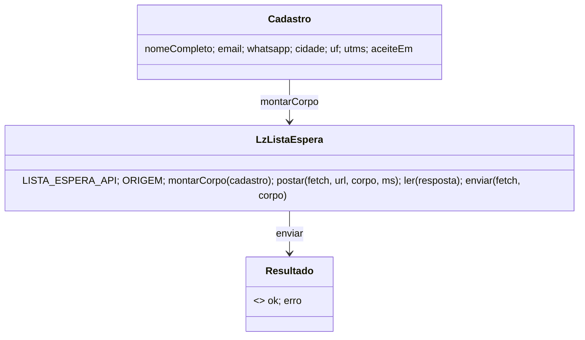

# A lista de espera grava na nossa API e o chat fica desligado (STORY-002-001, STORY-002-002)

> Requisito: `requirements/[User-story-02]lista-de-espera-na-api-e-chat-desligado.md` · Análise: `spdd/analysis/GGQPA-XXX-202610261559-[Analysis]-lista-de-espera-na-api-e-chat-desligado.md` · API: REQ-032 (`../app-backend/docs/contrato-integracao-crm.md` §11, backend `90eaf96`).
> **Status:** APROVADO — por delegação: Natanael, 2026-10-26, segue a cadeia. Literal: "pode seguir com a semente 02 e desative o chet. Esconda ele."

## Requirements

O formulário de `/em-breve` posta na rota pública do REQ-032 com o corpo do contrato, mantém obrigado, erro e UTMs; o chat fica desligado por um interruptor; nenhuma referência viva ao backend antigo. Fora: backend, textos, tipo de negócio e origem do clique na API.

## Entities

## Approach

- Lógica pura em `lp/em-breve/lista-espera.js` (UMD, ES5, sem DOM e sem `console`), carregada antes do `script.js`. Se não carregar, o envio mostra a mensagem padrão.
- Decididas (aprovação da semente): D1 endpoint num ponto só · D2 só campos do DTO · D3 `origin: 'coming-soon'` · D4 `privacyAcceptedAt` + um reenvio sem ele em `400` · D5 toda falha → mensagem padrão, sem ramo `409` · D6 backend intocado.
- Chat: `CHAT_ATIVO = false` + `API = ''` no `chat.js`; inclusão segue comentada.

## Structure

| Arquivo | Muda | Operation |
|---|---|---|
| `lp/em-breve/lista-espera.js`, `lp/_lab/em-breve/lista-espera.js` | nascem (iguais) | OP-1 |
| `lp/em-breve/script.js`, `lp/_lab/em-breve/script.js` | endpoint sai; submit usa `LzListaEspera` | OP-2 |
| `lp/em-breve/index.html`, `lp/_lab/em-breve/index.html` | `<script src=".../lista-espera.js?v=1">`, `script.js?v=10`, comentário do chat | OP-2, OP-3 |
| `lp/em-breve/chat.js`, `lp/_lab/em-breve/chat.js` | interruptor, `API` vazio, como reativar | OP-3 |
| `testes/lista-espera.test.mjs` | nasce | OP-4 |
| `requirements/INDEX.md`, `spdd/INDEX.md` | linha da cadeia | OP-5 |

Sem mudança em `lp/vercel.json`, `.vercelignore` e `build-lp.mjs`.

## Operations

### OP-1 Lógica da lista de espera (STORY-002-001)

- `LISTA_ESPERA_API` = `https://cu2viedkfvwuiuauvvi4guzdnm0ktprm.lambda-url.sa-east-1.on.aws/api/v1/marketing/landing-leads`; `ORIGEM` = `coming-soon`.
- `montarCorpo({nomeCompleto, email, whatsapp, cidade, uf, utms, aceiteEm})`: o mapeamento da análise; campos vazios omitidos; nenhum campo fora do DTO.
- `postar(fetch, url, corpo, ms=15000)`: `POST` JSON só com `Content-Type`, `AbortController`; resolve `{status}` ou `{rede:true}`.
- `ler(r)`: `2xx` → `ok`; resto → `erro`.
- `enviar(fetch, corpo, url?)`: posta; `400` com `privacyAcceptedAt` → posta de novo sem ele (uma vez); devolve `ler`.

### OP-2 O formulário liga a lógica (STORY-002-001)

- `script.js`: sai `WAITLIST_ENDPOINT` e o ramo `409`; o submit monta o `Cadastro` (UF de `resolveUf()`, `aceiteEm = new Date().toISOString()`), chama `enviar(window.fetch, …)`; `ok` → `dataLayer` `waitlist_signup` + `irParaObrigado`; `erro` → `ERRO_PADRAO`. Cabeçalho cita este canvas.
- `index.html`: `lista-espera.js?v=1` com `defer` antes do `script.js?v=10`.

### OP-3 Chat desligado (STORY-002-002)

- `chat.js`: `var CHAT_ATIVO = false;` e `if (!CHAT_ATIVO) return;` antes de qualquer DOM; `API = ''`; comentário "como reativar": backend novo de chat → `API`, `CHAT_ATIVO = true`, descomentar a inclusão no `index.html`, subir o `?v=`.
- `index.html`: o comentário da inclusão aponta para o interruptor.

### OP-4 Testes

- `testes/lista-espera.test.mjs` (`node:test`, `fetch` falso, sem rede): corpo do AC1 com chaves exatas; só um nome e UTM vazia; whatsapp só dígitos; `201` → ok; `400`/`429`/`500`/rede → erro; `400` → reenvio sem `privacyAcceptedAt` (2 chamadas, a 2ª sem a chave); `postar` sem PII na URL; o `chat.js` rodado em `vm` com `document`/`fetch` que falham se tocados não toca nada; nenhum `wygq…` em `lp/` (fora `blog`).

### OP-5 Registro

- Linha em `spdd/INDEX.md`; `## Sync` aqui se o código divergir sem mudar comportamento.

## Norms

- `CLAUDE.md` §Regras; `.claude/spdd-perfil.md` §Generate; ES5 no estilo do `script.js`.

## Safeguards

- **S1 só o DTO:** nenhum campo fora de `firstName, lastName, email, whatsapp, city, state, origin, utmSource, utmMedium, utmCampaign, utmContent, utmTerm, privacyAcceptedAt`.
- **S2 sem PII exposta:** dados só no corpo do `POST`; o `dataLayer` recebe só `{event, form_id, lgpd_consent}`; o obrigado leva só o clique (como hoje).
- **S3 erro como hoje:** a mensagem padrão do HTML.
- **S4 chat sem rede:** desligado, o `chat.js` não toca DOM nem rede.
- **S5 deploy:** `vercel.json`, `.vercelignore` e `build-lp.mjs` intocados.

## Matriz de rastreabilidade

| AC | Operation | Verificação |
|---|---|---|
| 002-001 AC1, AC2 | OP-1 `montarCorpo` | teste do corpo |
| 002-001 AC3 | OP-1 `ler`; OP-2 | teste 201 |
| 002-001 AC4 | OP-1 `postar`, `ler`; OP-2 | teste 400/429/500/rede |
| 002-001 AC5 | OP-1 `enviar` | teste do reenvio |
| 002-002 AC1 | OP-3 | teste `vm` |
| 002-002 AC2 | OP-3 | teste do grep |

## Decisões pendentes

- **Backend:** aceitar o tipo de negócio e os ids de clique (gclid/fbclid/landingPage/referrer) no DTO do REQ-032; até lá, não são gravados e a política descreve mais do que é guardado.

## Sync (26/10/2026, generate)

Sem mudança de comportamento: o `script.js` perdeu o `lerOrigem`/`ORIGEM_CAMPOS` (a origem não vai mais) e ficou com um comentário dizendo por quê; o `chat.js` sai também quando `API` está vazio (`!CHAT_ATIVO || !API`). Verificação: `npm test` 16/16 (7 novos); `node build-lp.mjs` sem erro (os 3 CSS que o build regenerou crus, por falta do `lightningcss`, voltaram ao `HEAD`); `grep wygqjkfsc7qzc3chhzwztorula0kuzbw lp/` vazio.
