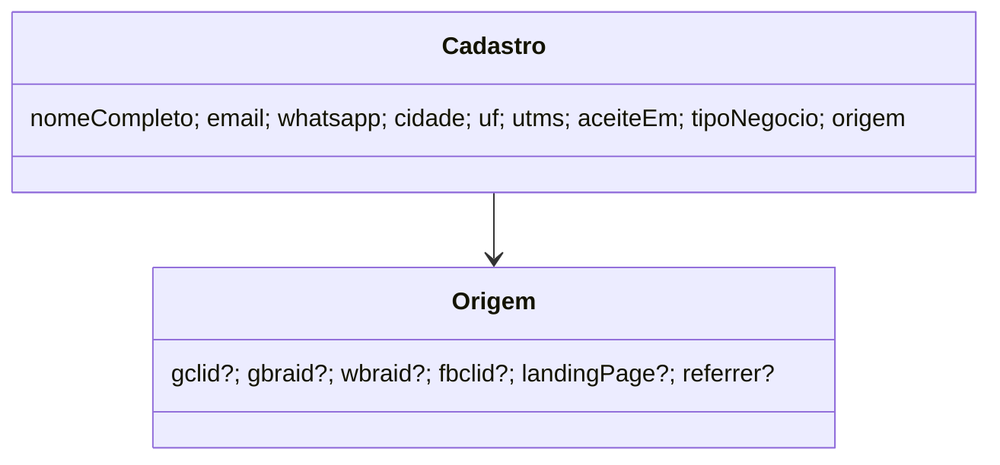

# O cadastro da lista de espera leva o tipo de negócio e o clique do anúncio (STORY-003-001)

> Requisito: `requirements/[User-story-03]tipo-de-negocio-e-clique-na-lista-de-espera.md` · Análise: `spdd/analysis/GGQPA-XXX-202610261855-[Analysis]-tipo-de-negocio-e-clique-na-lista-de-espera.md` · API: REQ-058 (`../app-backend/docs/contrato-integracao-crm.md` §11, backend `aa2c210`).
> **Status:** APROVADO — Natanael, 2026-10-26, segue a cadeia. Literal: "sim, altere a API para guardar essas informações".

## Requirements

`montarCorpo` volta a levar `businessType` e `gclid, gbraid, wbraid, fbclid, landingPage, referrer`, limpos no formato do REQ-058; `enviar` reenvia sem eles num `400`. Fora: políticas, `/origem.js`, obrigado.

## Entities

## Approach

- `lista-espera.js`: `TIPOS_NEGOCIO`, `CAMPOS_REQ058`, `semQuery`, `idDeClique`, `caminho`, `referrer`; `montarCorpo` acrescenta os válidos; `enviar` tenta `[corpo, sem REQ-058, sem REQ-058 e sem aceite]`, pulando passo que não muda o corpo, só enquanto a resposta for `400`.
- `index.html`: `data-business-type` em cada opção; `lista-espera.js?v=2`, `script.js?v=11`.
- `script.js`: `lerOrigem()` (sessionStorage, falha = `{}`) e o `data-business-type` da opção escolhida no `Cadastro`.

## Structure

| Arquivo | Muda | Operation |
|---|---|---|
| `lp/em-breve/lista-espera.js`, `lp/_lab/em-breve/lista-espera.js` | campos novos e reenvio | OP-1 |
| `lp/em-breve/index.html`, `lp/_lab/em-breve/index.html` | `data-business-type`, `?v=` | OP-2 |
| `lp/em-breve/script.js`, `lp/_lab/em-breve/script.js` | `lerOrigem`, tipo no cadastro | OP-2 |
| `testes/lista-espera.test.mjs` | AC1 a AC3; trava dos `?v=` | OP-3 |
| `requirements/INDEX.md`, `spdd/INDEX.md` | linha da cadeia | OP-4 |

## Operations

### OP-1 Corpo e reenvio
### OP-2 Formulário liga o tipo e a origem
### OP-3 Testes (antes do código): corpo do AC1 com chaves do DTO; limpeza do AC2; reenvio do AC3; `429`/rede não reenviam; as três opções do HTML têm o código certo.
### OP-4 Registro

## Safeguards

- **S1 só o DTO:** nenhum campo fora dos 13 do REQ-032 e dos 7 do REQ-058.
- **S2 sem query:** nada com `?` ou `#` sai em `landingPage`/`referrer`; nada de PII no `dataLayer` ou na URL do obrigado.
- **S3 nenhum cadastro perdido por campo novo:** reenvio da D3.
- **S4 deploy:** backend antes; `vercel.json`, `.vercelignore` e `build-lp.mjs` intocados.

## Decisões pendentes

- Políticas (`lp/privacidade.html`, `lp/excluir-conta.html:164`, `lp/cookies.html:101`): conferir se a redação bate com o que é gravado (tipo, ids de clique, página de entrada e referrer sem query).
